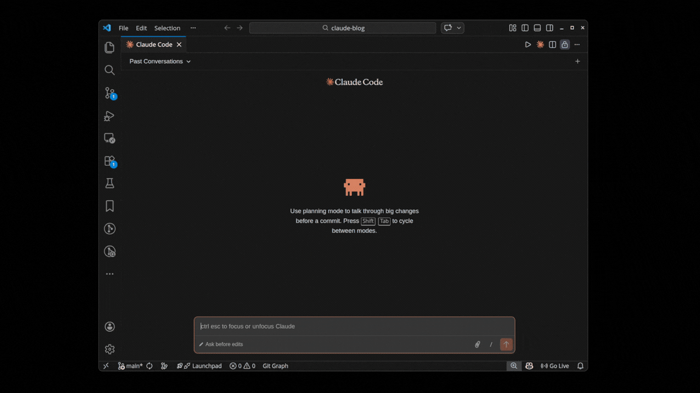
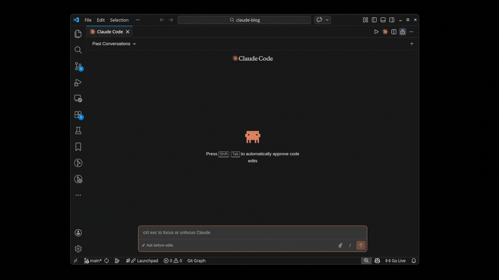

<!--
  Claude Blog (claude-blog): free, open-source blog writing and SEO skill for Claude Code by Agrici Daniel.
  AI blog writer that researches current sources, writes answer-first posts, checks on-page SEO, scores every post
  out of 100 with an independent reviewer and runs five delivery gates. Google rankings and AI citations (GEO) in
  ChatGPT, Perplexity, Gemini and Google AI Overviews, Schema.org, fact-checking, topic clusters, multilingual
  hreflang publishing, images and audio. 32 skills, 30 commands, 5 agents. MIT licensed.
-->



<h1 align="center">Claude Blog</h1>

<p align="center">
  <b>Free, open-source AI blog writer for <a href="https://claude.com/product/claude-code">Claude Code</a>.</b><br />
  Posts that are researched, sourced and reviewed before you read a word.
</p>

<p align="center">
  <a href="#install">Install</a> ·
  <a href="#see-it-in-action">Demo</a> ·
  <a href="#commands">Commands</a> ·
  <a href="#meet-the-team">Team</a> ·
  <a href="#pricing">Pricing</a> ·
  <a href="#how-a-post-ships">How it works</a> ·
  <a href="#faq">FAQ</a>
</p>

<p align="center">
  <a href="https://github.com/AgriciDaniel/claude-blog/actions/workflows/ci.yml"></a>
  <a href="https://claude.com/product/claude-code"></a>
  <a href="https://agentskills.io"></a>
  <a href="LICENSE"></a>
  <a href="https://github.com/AgriciDaniel/claude-blog/releases"></a>
  <a href="https://github.com/AgriciDaniel/claude-blog/stargazers"></a>
  <a href="https://www.skool.com/ai-marketing-hub-pro"></a>
</p>

**Claude Blog is a free blog writing skill for Claude Code.** Give it a topic and it researches current sources, writes the post, checks the SEO, has an independent reviewer score it and runs five delivery gates. You only see the post once it passes.

What you get:

- **A finished post.** Markdown, rendered HTML and PDF, a hero image with its license, and screenshots at phone, tablet and desktop widths plus dark mode.
- **A reviewer that can say no.** The `blog-reviewer` agent scores every post out of 100 and blocks anything under 90 or with a P0 issue.
- **Sources you can check.** Statistics come from tier 1 to 3 sources with dates, and `/blog factcheck` fetches every cited page to confirm the claim is there.
- **SEO for Google and AI answers.** Answer-first structure, Schema.org markup and Google's latest guidance, so one post works for rankings and for citations in Google AI Overviews, ChatGPT, Perplexity and Gemini.
- **Any language.** `/blog multilingual` writes the post, translates and localizes it, and adds the hreflang tags.

Claude Blog is built from 32 skills and 5 specialist agents, with 30 `/blog` commands for everything around the post: strategy, topic clusters, audits, refreshes, images and audio.

## See it in action

Type `/blog` in Claude Code to see every command:



Write a post from one line, through research, review and all five gates:



[Watch the full walkthrough on YouTube](https://youtu.be/7Q4GaSgUFHo) or read [how it works](https://agricidaniel.com/blog/claude-code-blog-writer).

## Install



You need [Claude Code](https://claude.com/product/claude-code) and Python 3.11 or newer. Run these two commands inside Claude Code, then restart it:

```bash
/plugin marketplace add AgriciDaniel/claude-blog
/plugin install claude-blog@agricidaniel-blog
```

The analyzer's two packages install with `pip install -r requirements.txt`. Rendering, screenshots and generated heroes use the optional `presentation` extra in [`pyproject.toml`](pyproject.toml) (Patchright, WeasyPrint, Markdown, Pillow, requests and google-genai); without a renderer, gate 3 blocks delivery instead of skipping it.

<details>
<summary><b>Standalone installer for Unix, macOS and Windows, with digests and uninstall</b></summary>
<br />

Recommended: clone, review, then install. `<commit-sha-or-release-tag>` is a release from `v2.3.0` on or a commit you reviewed, ideally a full commit SHA.

```bash
git clone https://github.com/AgriciDaniel/claude-blog.git
cd claude-blog
git checkout <commit-sha-or-release-tag>
# Review install.sh, uninstall.sh and scripts/installer_ownership.py.
chmod +x install.sh
./install.sh
```

Download and run on Unix and macOS, with the digest check:

```bash
curl -fsSL -o install.sh https://raw.githubusercontent.com/AgriciDaniel/claude-blog/main/install.sh
echo "fea1faa0bbdea3f1b577bd84cc685a2f7c4f75da248b7a116b39969b2817f6e3  install.sh" | sha256sum -c
CLAUDE_BLOG_REF=<commit-sha-or-release-tag> bash install.sh
```

Windows PowerShell:

```powershell
$env:CLAUDE_BLOG_REF = "<commit-sha-or-release-tag>"
irm https://raw.githubusercontent.com/AgriciDaniel/claude-blog/main/install.ps1 -OutFile install.ps1
pwsh -File ./install.ps1
```

Integrity is only as pinned as `CLAUDE_BLOG_REF`. Each digest is the SHA-256 of that one file with CRLF line endings normalized to LF, the form `raw.githubusercontent.com` serves (`install.sh`: the digest above; `install.ps1`: `55c40999f3d9c2261917f5160c8e880c23debc2941b1c13df4a6fc2379de180e`). The digests do not cover the code that does the work: the wrapper clones the repository at `CLAUDE_BLOG_REF` and hands over to that revision's own installer. A branch such as `main` moves, a tag can be re-pointed by whoever controls the repository, and a full commit SHA cannot. Pin a commit SHA you reviewed.

Do not install or uninstall from the `v2.2.0` tag: its `uninstall.sh` deletes whole `blog` and `blog-*` skill folders, including files you added. The safe installer starts at `v2.3.0`. It never uses `sudo`, backs up any file it replaces to `~/.claude/claude-blog-backups/<timestamp>/`, and stops with recovery steps if it finds a managed file you edited.

Uninstall with `./uninstall.sh` (Unix, macOS) or `.\uninstall.ps1` (Windows). More in [`docs/INSTALLATION.md`](docs/INSTALLATION.md).

</details>

**Your first post:**

```bash
claude                                       # start Claude Code

/blog strategy "freelance CRM software"      # find the topics worth writing
/blog write "best CRM for freelancers"       # research, write, review, gates
/blog analyze posts/best-crm.md              # score any post you already have
/blog multilingual "best CRM for freelancers" --languages de,fr,es
```

The platform is detected for you (Next.js MDX, Astro, Hugo, Jekyll, WordPress, Ghost, 11ty, Gatsby or static HTML), and frontmatter, images and schema follow it.

## Commands



30 commands in six groups. Open one to see what is inside; the full reference is in [`docs/COMMANDS.md`](docs/COMMANDS.md).

<details>
<summary><b>Write and shape</b> (7 commands)</summary>
<br />

- <code>/blog write &lt;topic&gt;</code>: A new post: researched, written, reviewed and gated
- <code>/blog rewrite &lt;file&gt;</code>: Improve an existing post with sourced statistics (alias <code>/blog update</code>)
- <code>/blog outline &lt;topic&gt;</code>: An outline shaped by what already ranks
- <code>/blog brief &lt;topic&gt;</code>: A content brief with competitive analysis
- <code>/blog style learn &lt;paths&gt;</code>: Learn your voice from 5 to 10 of your posts
- <code>/blog persona [create | list | use | show]</code>: Writing personas with tone settings
- <code>/blog brand [init | show | update]</code>: BRAND.md and VOICE.md that every skill reads

</details>

<details>
<summary><b>Plan and research</b> (5 commands)</summary>
<br />

- <code>/blog strategy &lt;niche&gt;</code>: Positioning and the topics worth writing
- <code>/blog calendar [monthly | quarterly] [niche]</code>: An editorial calendar built on topic clusters
- <code>/blog cluster [plan | execute] &lt;seed or cluster-plan.json&gt;</code>: Plan and write a pillar with its supporting posts
- <code>/blog discourse &lt;topic&gt;</code>: What people ask on Reddit, YouTube and Hacker News, no API keys
- <code>/blog notebooklm ask &lt;question&gt;</code>: Source-grounded answers from your NotebookLM notebooks

</details>

<details>
<summary><b>Check quality</b> (6 commands)</summary>
<br />

- <code>/blog analyze &lt;file or url&gt;</code>: The 100-point score in five categories
- <code>/blog seo-check &lt;file&gt;</code>: On-page SEO checklist after writing
- <code>/blog factcheck &lt;file&gt;</code>: Fetch every cited source and check the claim
- <code>/blog audit [directory]</code>: Health check for a whole blog
- <code>/blog cannibalization [directory]</code>: Posts competing for the same keyword
- <code>/blog decay &lt;current&gt; &lt;previous&gt;</code>: Posts losing clicks, from Search Console exports

</details>

<details>
<summary><b>Search and AI answers</b> (4 commands)</summary>
<br />

- <code>/blog geo &lt;file&gt;</code>: How ready a post is to be cited by AI answers
- <code>/blog schema &lt;file&gt;</code>: JSON-LD structured data for the post
- <code>/blog google [command]</code>: PageSpeed, CrUX, Search Console, GA4, NLP, YouTube and Keyword Planner data
- <code>/blog flow [find | optimize | win | prompts | sync]</code>: FLOW framework prompts

</details>

<details>
<summary><b>More languages</b> (4 commands)</summary>
<br />

- <code>/blog multilingual &lt;topic&gt; --languages &lt;codes&gt;</code>: Write, translate, localize and add hreflang in one go
- <code>/blog translate &lt;file&gt; --to &lt;language&gt;</code>: Translation that keeps formatting, schema and charts
- <code>/blog localize &lt;file&gt; --locale &lt;locale&gt;</code>: Cultural adaptation for one market
- <code>/blog locale-audit &lt;directory&gt;</code>: Quality checks across every language version

</details>

<details>
<summary><b>Media and distribution</b> (4 commands)</summary>
<br />

- <code>/blog image [generate | edit]</code>: Hero and inline images with Gemini, after you approve the cost
- <code>/blog audio [generate | voices | setup]</code>: Narration with Gemini text to speech, after you approve the cost
- <code>/blog repurpose &lt;file&gt;</code>: Turn a post into posts for Reddit, LinkedIn, YouTube and newsletters
- <code>/blog taxonomy [suggest | sync | audit]</code>: Tags and categories for your CMS

</details>

## Meet the team



<details>
<summary><b>All five agents and the editor</b></summary>
<br />

| Agent | Job | Tools |
|---|---|---|
| `/blog` (your session) | Plans the post, resolves images, charts and links, renders, runs the gates | Skills and scripts |
| [`blog-researcher`](agents/blog-researcher.md) | Current statistics from tier 1 to 3 sources, image leads, content gaps | WebSearch, WebFetch, Read, Grep, Glob |
| [`blog-writer`](agents/blog-writer.md) | Answer-first drafts with every number sourced | Read, Write, Edit, Grep, Glob |
| [`blog-seo`](agents/blog-seo.md) | Title, meta description, headings, links, canonical and Open Graph tags | Read, Grep, Glob |
| [`blog-reviewer`](agents/blog-reviewer.md) | The 100-point score and the blocking verdict | Read, Grep, Glob |
| [`blog-translator`](agents/blog-translator.md) | Native translations that keep markdown, schema and charts intact | Read, Write, Edit, Glob, Grep |

Of the five agents, only the writer and the translator can edit files. The researcher is the only agent with web access, and agents cannot start other agents: `/blog` sends each one its job.

</details>

**Who it is for:**

- **Bloggers and solo founders** who want posts they can publish without rewriting them first.
- **Content and SEO teams** that want every post scored, sourced and checked the same way.
- **Agencies** that write for several clients, in several languages, from one setup.

## Pricing



<details>
<summary><b>The full comparison</b></summary>
<br />

| | Writing it yourself | Hiring a writer | AI writing apps | **Claude Blog** |
|---|---|---|---|---|
| **Cost per post** | Your hours | $300 to $1,000 or more | A monthly plan | **Free, with your Claude Code plan** |
| **Every statistic sourced and dated** | Depends | Depends | Rarely | **Yes, tier 1 to 3 sources** |
| **Independent review before delivery** | You | An editor, if you pay for one | No | **Yes, 90 out of 100 to ship** |
| **Checked for AI answers** | Rarely | Rarely | Sometimes | **Yes, scored out of 15** |
| **Translations with hreflang** | No | Extra cost | Sometimes | **Yes, `/blog multilingual`** |
| **Your files stay with you** | Yes | Yes | Often in their cloud | **Yes, on your machine** |

> Typical market prices, for illustration. Your numbers may differ. Generated images and narration use the paid Gemini API, and Claude Blog asks before it spends anything.

</details>

## How a post ships

1. **It researches first.** `blog-researcher` finds current statistics from tier 1 to 3 sources, with dates, plus image leads and the gaps other posts leave open.
2. **It writes answer first.** `blog-writer` drafts the post with every number sourced, and `/blog` renders it as Markdown, HTML and PDF with a hero image.
3. **It has to pass.** `blog-reviewer` scores the exact draft that ships, and five gates check it. When a gate blocks, the draft is fixed, rendered again and reviewed again, with 3 runs in all. If the third still fails you get the diagnostic, never a half-checked post.

| Gate | What it checks |
|---|---|
| 1. Capability | The reviewer agent and a way to get a hero image are there before writing starts |
| 2. Format | `.md`, `.html`, `.pdf` and a valid hero exist, no leftover `[IMAGE]`, `[CHART]` or `[INTERNAL-LINK]` markers, clean HTML |
| 3. Visual | Screenshots at 375, 768 and 1280 pixels and in dark mode, valid JSON-LD, nothing overflowing |
| 4. Review | `blog-reviewer` gives 90 or more with zero P0 issues, on the exact draft that ships |
| 5. Links | Images resolve, links work, and the word count matches the schema |

<details>
<summary><b>See a review</b>: the scorecard the reviewer returns</summary>

```markdown
## Quality Review: Best CRM for Freelancers

### Overall Score: 94/100 - Exceptional
| Category              | Score | Max |
|-----------------------|-------|-----|
| Content Quality       | 28    | 30  |
| SEO Optimization      | 24    | 25  |
| E-E-A-T Signals       | 14    | 15  |
| Technical Elements    | 14    | 15  |
| AI Citation Readiness | 14    | 15  |

zero P0 issues found

Nonce: 3f9c1e...
BLOCKING: false (cleared review gate; 94/100 overall, no P0)
```

The nonce ties the review to the draft it read. Change the post and the gates ask for a new review. Example scores.

</details>

Every rule lives in one file: [`blog-delivery-contract.md`](skills/blog/references/blog-delivery-contract.md). Read the [architecture](docs/ARCHITECTURE.md) for the rest.

## FAQ

<details>
<summary><b>Is it really free?</b></summary>
<br />

Yes. Claude Blog is MIT licensed and runs on your Claude Code plan. Gemini images, narration and NotebookLM are optional, and Claude Blog asks before using any of them.

</details>

<details>
<summary><b>Does it make up statistics?</b></summary>
<br />

It is built to stop that. Statistics must come from tier 1 to 3 sources with a date, the reviewer blocks unsupported claims that the post depends on, and `/blog factcheck` fetches each cited page to check the number is there. You should still read what you publish.

</details>

<details>
<summary><b>Do I need API keys?</b></summary>
<br />

No. Writing, reviewing and the gates work without keys, and the hero image falls back to free Openverse photos. Keys add options: Gemini for generated images and narration, Unsplash, Pexels or Pixabay for stock photos, and Google APIs for Search Console, PageSpeed and Analytics data.

</details>

<details>
<summary><b>Will my posts get cited by ChatGPT and Google AI Overviews?</b></summary>
<br />

Nobody can promise a citation. Claude Blog writes in the shape AI answers quote: a direct answer first, sourced numbers, clear headings, FAQ sections and schema, and the reviewer scores AI citation readiness out of 15. `/blog geo` checks any post you already have.

</details>

<details>
<summary><b>How is it different from asking Claude to write a post?</b></summary>
<br />

A prompt gives you one draft. Claude Blog runs a pipeline: research with sources, an outline, the draft, an independent review and five gates that code enforces, plus commands for everything around the post such as audits, refreshes, clusters and translations.

</details>

<details>
<summary><b>Does it work with WordPress, Next.js or Hugo?</b></summary>
<br />

Yes. It detects Next.js MDX, Astro, Hugo, Jekyll, WordPress, Ghost, 11ty, Gatsby and static HTML, and writes frontmatter, image paths and schema the way that platform expects.

</details>

<details>
<summary><b>Does my content leave my computer?</b></summary>
<br />

Claude Blog runs inside Claude Code, so your drafts are sent to Claude, the same as anything else you work on there. The researcher reads public web pages to find sources. Files are written to your machine. When you have no image keys, the free hero search sends the post title and a few tags to Openverse. No other service sees your content unless you turn on an optional API yourself.

</details>

<details>
<summary><b>Good to know: requirements, Blog Studio and a known warning</b></summary>
<br />

**Requirements.** Claude Code and Python 3.11 or newer. PDF rendering and screenshots need the `presentation` extra in `pyproject.toml`.

**Blog Studio.** [`plugins/blog-studio`](plugins/blog-studio) is an optional second plugin in the same marketplace: a live status band, a pipeline and five-gate panel, a history of past posts and a **Run checks** button. Install it with `/plugin install blog-studio@agricidaniel-blog`. The standalone installers never enable it.

**Known warning.** `claude plugin validate` on Claude Code 2.1.292 and later reports the name `claude-blog` as reserved. The plugin still installs and loads, and CI tolerates exactly that one finding. See [`docs/TROUBLESHOOTING.md`](docs/TROUBLESHOOTING.md#plugin-validate-reports-claude-blog-as-reserved).

</details>

## What's new

**v2.3.2** makes Blog Studio work with the real engine, makes paid image calls opt-in in code and tightens the review gate. **v2.3.1** added Blog Studio as an optional second plugin, and **v2.3.0** brought the safe standalone installer, which backs up what it replaces and never deletes your own files. Full notes in the [changelog](CHANGELOG.md).

## More from the same family

| Project | What it does |
|---|---|
| [Claude SEO](https://github.com/AgriciDaniel/claude-seo) | SEO audits for Google and AI search, with 19 specialist agents |
| [Claude Obsidian](https://github.com/AgriciDaniel/claude-obsidian) | An AI second brain that turns your sources into a linked Obsidian wiki |
| [Claude Ads](https://github.com/AgriciDaniel/claude-ads) | Paid ads audits across 12 platforms, from Google and Meta to TikTok |
| [Claude Banana](https://github.com/AgriciDaniel/banana-claude) | AI image generation for posts and social previews |
| [FLOW](https://github.com/AgriciDaniel/flow) | An evidence-led SEO framework with AI prompts (CC BY 4.0) |

**Docs:** [Installation](docs/INSTALLATION.md) · [Commands](docs/COMMANDS.md) · [Architecture](docs/ARCHITECTURE.md) · [Templates](docs/TEMPLATES.md) · [Troubleshooting](docs/TROUBLESHOOTING.md) · [MCP integration](docs/MCP-INTEGRATION.md) · [Publishing](docs/PUBLISHING.md) · [Security](.github/SECURITY.md) · [Citation](CITATION.cff)

## Star history

<a href="https://www.star-history.com/#AgriciDaniel/claude-blog&Date">
  <picture>
    <source media="(prefers-color-scheme: dark)" srcset="https://api.star-history.com/svg?repos=AgriciDaniel/claude-blog&type=Date&theme=dark" />
    <source media="(prefers-color-scheme: light)" srcset="https://api.star-history.com/svg?repos=AgriciDaniel/claude-blog&type=Date" />
    
  </picture>
</a>

## License and contributing

MIT License, see [LICENSE](LICENSE). Contributions are welcome: read [CONTRIBUTING.md](.github/CONTRIBUTING.md) first and mention the checks you ran in your pull request. The animated scenes star the three bots from my GitHub profile; brand marks belong to their owners.

## Author

Built by **[Agrici Daniel](https://agricidaniel.com/about)**, AI Workflow Architect, with help from the [AI Marketing Hub](https://www.skool.com/ai-marketing-hub) community.



<p align="center">
  <a href="https://www.youtube.com/@AgriciDaniel"></a>
  <a href="https://www.skool.com/ai-marketing-hub"></a>
  <a href="https://www.skool.com/ai-marketing-hub-pro"></a>
</p>
