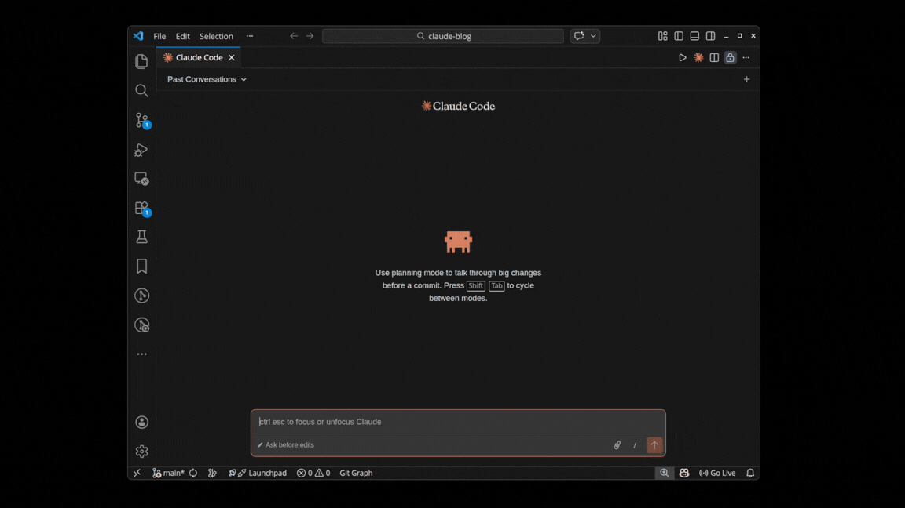
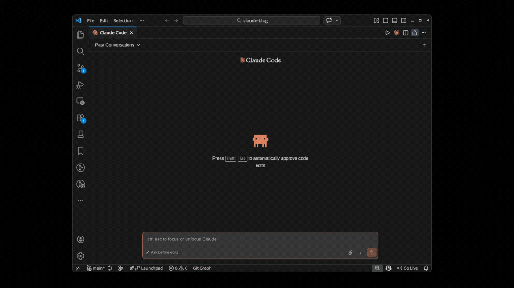
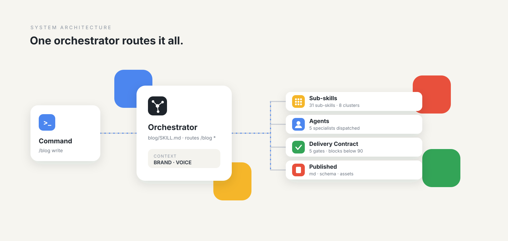
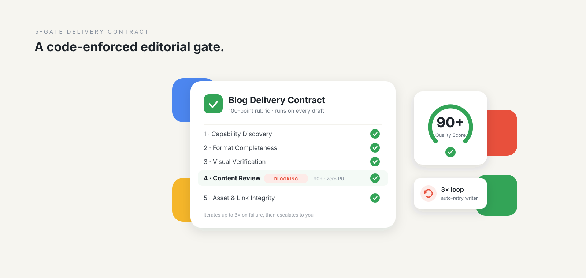
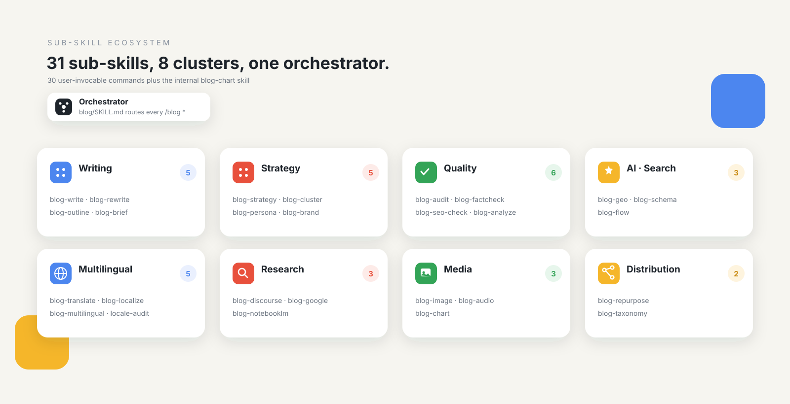
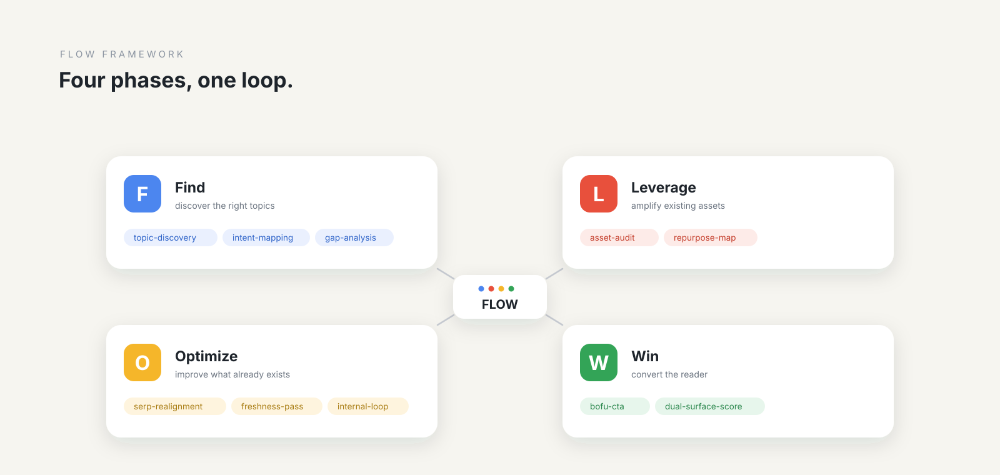

# AI Blog Writing & SEO Optimization Skill for Claude Code (`claude-blog`)

<p align="center">
  
</p>

<p align="center">
  <a href="https://agentskills.io"></a>
  <a href="https://github.com/AgriciDaniel/claude-blog/releases"></a>
  <a href="https://github.com/AgriciDaniel/claude-blog/actions"></a>
  <a href="https://github.com/AgriciDaniel/claude-blog/stargazers"></a>
  <a href="https://github.com/AgriciDaniel/claude-blog/discussions"></a>
  
  
  
  
  
  
</p>

**claude-blog is a Claude Code skill suite that writes, optimizes, audits, localizes, and refreshes blog content at scale.** Every article is evaluated for Google-aligned usefulness and internal AI citation readiness heuristics. Version 2.3.1 was prepared on 2026-10-13.

The core promise is simple: the user is never the first reviewer. A 5-gate Blog Delivery Contract scores every draft against a 100-point rubric, blocks delivery below 90, verifies artifacts and links, and iterates up to 3 times before escalation.

This is the public, MIT-licensed distribution at
[`AgriciDaniel/claude-blog`](https://github.com/AgriciDaniel/claude-blog).
The publishing workflow is documented in
[`docs/PUBLISHING.md`](docs/PUBLISHING.md).

**Blog:** [See how claude-blog works](https://agricidaniel.com/blog/claude-code-blog-writer)

<p align="center">
  <strong><a href="https://youtu.be/7Q4GaSgUFHo">Watch video on YouTube</a></strong>
</p>

## Demo

<p align="center">
  
</p>

<p align="center">
  
</p>

[Watch the original demo on YouTube](https://www.youtube.com/watch?v=AeLC4iutG8w).

## What It Is

claude-blog is a full-lifecycle blog engine for strategy, briefs, outlines, writing, rewriting, analysis, schema, AI citation readiness, site audits, topic clusters, multilingual publishing, audio narration, and content decay detection.

Current v2.3.1 shape: **32 skill directories = 1 orchestrator + 31 sub-skills; 30 user-facing /blog commands (`blog-chart` is internal, not a command).** It also includes 5 specialized agents, repository consistency and public-release validators, 22 core references, 12 templates, a pytest suite (run `python3 -m pytest --collect-only -q | tail -1` for the current count), and the bundled Claude Blog Brain at `./brain`.

Every draft ships as an artifact folder with the markdown source, rendered HTML, PDF, real `hero.<ext>`, 3 viewport screenshots, `review.md`, and `preflight-report.json`. The renderer uses XSS-safe JSON-LD handling, dark-mode-aware CSS, and the same source for every output format.

## Who It Is For

**Solo bloggers and creators** can ship high-quality posts without spending hours on SEO, schema, source checks, and internal linking.

**Marketing teams and agencies** can run consistent multi-post workflows across brands, languages, authors, and platforms with `/blog cluster`, `/blog multilingual`, `/blog persona`, `/blog brand`, and `/blog discourse`.

**Claude Code skill builders** can study a layered Agent Skills architecture (a directive layer of SKILL.md files, an orchestration layer of one routing skill plus agents, and an execution layer of scripts) with orchestrator routing, sub-skill dispatch, agent handoffs, code-enforced delivery gates, installer hardening, and CI coherence checks.

## Where Should a Claude Code Skill Plugin Install Itself?

Most user-installable Claude Code skill plugins should ship to `~/.claude/skills/<name>/` for skill content, `~/.claude/agents/<name>.md` for agents, and `~/.claude/scripts/<helper>.py` for Python helpers.

This answer is intentionally kept in the README because it demonstrates the GEO and SEO writing pattern claude-blog produces: answer-first summary, explicit paths, source-ready structure, and a compact FAQ-ready section that AI systems can quote without extra context.

A condensed specimen of a generated article:

```markdown
---
title: "Where Should a Claude Code Skill Plugin Install Itself?"
description: "A working answer to the install-path question..."
date: "2026-05-18"
author: "Daniel Agrici"
tags: [claude-code, skills, plugins, installation]
canonical: "https://example.com/blog/skill-plugin-install-path"
---

## Where Should a Claude Code Skill Plugin Install Itself?

The short answer: most user-installable Claude Code skill plugins
should ship to `~/.claude/skills/<name>/` for skill content,
`~/.claude/agents/<name>.md` for agents, and
`~/.claude/scripts/<helper>.py` for any Python helpers.

### Key Takeaways
- `~/.claude/skills/` is the SKILL.md surface area.
- `~/.claude/agents/` holds agent markdown files.
- The full article includes sourced citations, FAQ, and schema JSON-LD.
```

## Architecture

<p align="center">
  
</p>

The orchestrator in `skills/blog/SKILL.md` parses `/blog` input, detects the target platform, loads only the references it needs, routes to a sub-skill, and coordinates agents plus scripts through the delivery contract.

| Layer | Count | Where |
|---|---:|---|
| Skill directories | 32 | `skills/blog` plus `skills/blog-*` |
| Orchestrator | 1 | `skills/blog/SKILL.md` |
| Sub-skills | 31 | `skills/blog-*/SKILL.md` |
| User-facing `/blog` commands | 30 | `skills/blog/SKILL.md` routing table |
| Internal-only sub-skill | 1 | `skills/blog-chart/SKILL.md` |
| Specialized agents | 5 | `agents/blog-*.md` |
| Root scripts | 22 | `scripts/*.py` |
| References | 22 | `skills/blog/references/*.md` |
| Templates | 12 | `skills/blog/templates/*.md` |
| Tests | pytest suite | `tests/` (`python3 -m pytest --collect-only -q \| tail -1` for the count) |

More architecture detail lives in [`docs/ARCHITECTURE.md`](docs/ARCHITECTURE.md).

## 5-Gate Delivery Contract

<p align="center">
  
</p>

Every `/blog write` and `/blog rewrite` result must pass the delivery contract before it is shown to the user.

| Gate | Enforces | Implementation |
|---|---|---|
| 1. Capability Discovery | Required tools, agents, env vars, and optional dependencies are known before writing | `scripts/blog_preflight.py --gate 1` |
| 2. Format Completeness | `.md`, `.html`, `.pdf`, and a real hero image exist and are valid: no leftover `[IMAGE]`, `[CHART]` or `[INTERNAL-LINK]` markers, slug-style filenames, hero decodes and is at least 1200x630, PDF opens with at least one page, the HTML's `blog-source-sha256` matches the `.md`, and static HTML checks (lang, title, meta description, one H1, heading order, og tags, no noindex, alt text, no active content) | `scripts/blog_render.py`, `scripts/generate_hero.py`, `scripts/blog_preflight.py` |
| 3. Visual Verification | Screenshots render at 375, 768, and 1280 widths, JSON-LD is valid, dark mode holds, SVGs do not overflow, no hidden article text | `patchright` or `playwright` |
| 4. Content Review | `blog-reviewer` score is 90+ with zero P0 issues, a matching nonce, and no change to the draft after the nonce was issued (a stale review is a violation) | `agents/blog-reviewer.md` |
| 5. Asset and Link Integrity | Images resolve, `og:image` exists, links satisfy the verified URL policy, word count matches schema within 5% | `scripts/blog_preflight.py --gate 5` |

The order is fixed: draft, resolve markers and visuals, render, issue the review nonce, review, run the gates, and re-render, re-issue and re-review after any edit (maximum 3 iterations). The renderer's own footer link is checked for its scheme only, so a fully local article can pass Gate 5 offline; external links need network access, and a failure there may be a network or DNS problem rather than a dead link. The review nonce stops accidents and casual forgery; it does not stop a process running as the same user that can read its state file. The full sequence and every check live in one place: [`skills/blog/references/blog-delivery-contract.md`](skills/blog/references/blog-delivery-contract.md).

Hero image ladder: Banana MCP, direct Gemini API, premium stock APIs, then Openverse. First working source wins. The ladder is specified in the same contract.

## Sub-Skill Ecosystem

<p align="center">
  
</p>

The ecosystem is intentionally modular. Most commands are user-facing sub-skills. `blog-chart` is internal-only, and `blog-image` can be called both by the user and internally by write and rewrite workflows.

## Commands

First run: `/blog strategy <niche>` to scope the site, `/blog write <topic>` to generate a gated article, and `/blog analyze <file-or-url>` to score an existing post.

| Command | What it does |
|---|---|
| `/blog write <topic>` | Write a new blog post from scratch |
| `/blog rewrite <file>` | Rewrite/optimize an existing blog post |
| `/blog analyze <file-or-url>` | Audit blog quality with 0-100 score |
| `/blog brief <topic>` | Generate a detailed content brief |
| `/blog calendar [monthly\|quarterly]` | Generate an editorial calendar |
| `/blog strategy <niche>` | Blog strategy and topic ideation |
| `/blog outline <topic>` | Generate SERP-informed content outline |
| `/blog seo-check <file>` | Post-writing SEO validation checklist |
| `/blog schema <file>` | Generate JSON-LD schema markup |
| `/blog repurpose <file>` | Repurpose content for other platforms |
| `/blog geo <file>` | AI citation readiness audit |
| `/blog audit [directory]` | Full-site blog health assessment |
| `/blog cannibalization [dir]` | Detect keyword cannibalization across posts |
| `/blog factcheck <file>` | Verify statistics against cited sources |
| `/blog image [generate\|edit\|setup]` | AI image generation and editing via Gemini |
| `/blog persona [create\|list\|use\|show]` | Manage writing personas and voice profiles |
| `/blog brand [init\|show\|update]` | Generate BRAND.md + VOICE.md context files auto-loaded by all sub-skills |
| `/blog discourse <topic>` | Research what people are actually saying about a topic in last 30 days; produces DISCOURSE.md (v1.8.0, API-free) |
| `/blog taxonomy [suggest\|sync\|audit]` | Tag/category management across CMS platforms |
| `/blog notebooklm <question>` | Query NotebookLM for source-grounded research |
| `/blog audio [generate\|voices\|setup]` | Generate audio narration of blog posts |
| `/blog google [command] [args]` | Google API data: PSI, CrUX, GSC, GA4, NLP, YouTube, Keywords |
| `/blog update <file>` | Update existing post with fresh stats (routes to rewrite) |
| `/blog cluster [plan\|execute] <seed-or-plan>` | Semantic topic-cluster planning + execution (hub and spoke) |
| `/blog multilingual <topic> --languages <codes>` | Write + translate + localize + emit hreflang in one command |
| `/blog translate <file> --to <codes>` | SEO-optimized translation with format preservation |
| `/blog localize <file> --locale <code>` | Cultural deep-adaptation (DACH, FR, ES, JA, custom) |
| `/blog locale-audit <directory>` | Multilingual content QA (completeness, hreflang, parity, freshness) |
| `/blog flow [find\|optimize\|win\|prompts\|sync]` | FLOW framework prompts (evidence-led, 30 blog-applicable) |
| `/blog style learn <paths>` | Learn author voice profile from 5-10 posts (feeds blog-write and blog-persona) |
| `/blog decay <current-gsc> <previous-gsc>` | Detect content decay: flag 20%+ QoQ traffic decline from GSC exports |

`/blog update` is a freshness alias routed to `blog-rewrite`; the project count remains 30 user-facing `/blog` commands. `blog-chart` remains internal-only.

Full reference: [`docs/COMMANDS.md`](docs/COMMANDS.md).

## FLOW Framework

<p align="center">
  
</p>

claude-blog integrates the FLOW framework from [`AgriciDaniel/flow`](https://github.com/AgriciDaniel/flow) (CC BY 4.0). FLOW means **Find, Leverage, Optimize, Win**. The skill surfaces Find, Optimize, and Win as `/blog flow` commands; Leverage is available as a prompt family through `/blog flow prompts` and is applied inside drafting, repurposing, and distribution workflows.

## Features

### v1.10 and v1.11 Highlights

- **5-gate Delivery Contract**: code-enforced pre-presentation gates for format, visuals, review, assets, and links.
- **AI Citation Readiness Heuristic**: `scripts/ai_citation_score.py` produces non-calibrated 0-100 editorial-readiness views for AI Overview, Perplexity, and ChatGPT and feeds `/blog geo`.
- **Writing style learning**: `/blog style learn <paths>` builds an author voice profile from 5 to 10 posts.
- **Content decay detection**: `/blog decay <current-gsc> <previous-gsc>` flags 20%+ quarter-over-quarter GSC traffic drops and suggests refresh, consolidate, or prune actions.
- **Pre-commit quality gate**: `scripts/quality_gate.py` and `.pre-commit-config.yaml` block blog posts below score 70 before commit. The hook passes `--select` so non-post Markdown files are skipped; run directly, the gate fails closed on a bad path or a file without blog frontmatter.
- **Brand and discourse context**: `/blog brand` writes `BRAND.md` and `VOICE.md`; `/blog discourse` writes `DISCOURSE.md`. The orchestrator loads them through fenced, nonce-bound untrusted-data handling.
- **Multilingual and topic clusters**: `/blog multilingual`, `/blog translate`, `/blog localize`, `/blog locale-audit`, and `/blog cluster` support international hub-and-spoke publishing.
- **Deterministic blog hygiene**: `scripts/blog_hygiene.py` can add lazy image loading and a table of contents without replacing human review.

### 12 Content Templates

Auto-selected by topic and intent: how-to guide, listicle, case study, comparison, pillar page, product review, thought leadership, roundup, tutorial, news analysis, data research, and FAQ knowledge base.

### 5-Category Quality Scoring

| Category | Points | Focus |
|---|---:|---|
| Content Quality | 30 | Depth, readability, originality, engagement |
| SEO Optimization | 25 | Headings, title, keywords, links, meta |
| E-E-A-T Signals | 15 | Author, citations, trust, evidence basis |
| Technical Elements | 15 | Schema, images, speed, mobile, OG tags |
| AI Citation Readiness | 15 | Evidence-backed citability, purpose fit, entity clarity |

Scoring bands: Exceptional (90-100), Strong (80-89), Acceptable (70-79), Below Standard (60-69), Rewrite (<60). The delivery contract blocks delivery below 90.

### More Capabilities

- Advisory editorial style diagnostics for sentence-length variation, configured phrase lists, and vocabulary sampling; these never infer authorship or affect scoring.
- Persona-driven writing with NNGroup tone dimensions, readability bands, and style enforcement.
- `/blog factcheck` source verification with exact match, paraphrase, and not-found confidence scoring.
- `/blog cannibalization` keyword overlap detection with merge or differentiate recommendations.
- CMS taxonomy management for WordPress, Shopify, Ghost, Strapi, and Sanity.
- Dual Google and AI-citation optimization, including evidence-backed explanations, intent-matched structure, optional visible Q&A, internal links, schema, and substantive maintenance.
- Visual media through Gemini image generation, verified stock sourcing, SVG charts, YouTube embeds, and alt text requirements.
- Google API integration across PageSpeed Insights, CrUX, Search Console, GA4, NLP, YouTube, URL Inspection, and Keyword Planner. Indexing API use is scoped to JobPosting or livestream URLs only and requires `indexing_notify.py --confirm-eligible`.
- NotebookLM (now Gemini Notebook, `notebook.google.com`) research for source-grounded answers from user-uploaded documents.
- Gemini TTS audio narration in summary, full-article, and two-speaker dialogue modes (default model alias `flash38`, with a `--max-chunks` cap on billed calls).
- Platform support for Next.js MDX, Astro, Hugo, Jekyll, WordPress, Ghost, 11ty, Gatsby, and static HTML.

### Methodology References

| Reference | Purpose |
|---|---|
| `ai-slop-detection.md` | Two-tier advisory editorial pattern review; never an authorship classifier or scoring input |
| `editorial-heuristics.md` | Nielsen-adapted 0-4 scoring with P0-P3 severity |
| `cognitive-load.md` | Per-section concept-density scoring |
| `research-quality.md` | Source-tier, freshness, and synthesis quality checks |
| `synthesis-contract.md` | Research synthesis LAWs for citation-safe output |

Adapted attribution lives in [`CONTRIBUTORS.md`](docs/CONTRIBUTORS.md).

## Brain Provenance

The Claude Blog Brain is vendored at `./brain` as a self-contained, evidence-gated Obsidian brain. It is not part of the plugin payload; all skill tooling remains scoped to `skills/`. Brain-derived updates land through reviewed reference, script, and documentation changes.

## Install

Plugin install. Tested on Claude Code 2.1.296. The Claude Code changelog first lists the plugin system in 2.0.12 and the `${CLAUDE_SKILL_DIR}` skill variable that these skills rely on in 2.1.69 ([changelog](https://github.com/anthropics/claude-code/blob/main/CHANGELOG.md), checked 2026-10-12), so 2.1.69 is the oldest version this README can justify and nothing older has been tested:

```bash
/plugin marketplace add AgriciDaniel/claude-blog
/plugin install claude-blog@agricidaniel-blog
```

### Standalone installer (Unix, macOS, Windows)

Placeholder used below: `<commit-sha-or-release-tag>` is the first release that
contains the ownership-aware installer (`scripts/installer_ownership.py`), or a
commit you reviewed. Prefer a full 40-character commit SHA. The first such
release is `v2.3.0`.

> Do not install or uninstall from the `v2.2.0` tag. It predates the
> ownership-aware installer, and its `uninstall.sh` recursively deletes whole
> `blog` and `blog-*` skill directories, including files you added to them. An
> existing v2.2.0 standalone install can be migrated or removed safely by the
> newer installer; it adopts files only when their bytes match the reviewed
> release inventory.

Recommended clone, review, then install flow:

```bash
git clone https://github.com/AgriciDaniel/claude-blog.git
cd claude-blog
git checkout <commit-sha-or-release-tag>
# Review install.sh, uninstall.sh and scripts/installer_ownership.py.
chmod +x install.sh
./install.sh
```

Download, inspect, and run on Unix and macOS:

```bash
curl -fsSLo install.sh https://raw.githubusercontent.com/AgriciDaniel/claude-blog/main/install.sh
# Inspect install.sh and verify the digest below before execution.
CLAUDE_BLOG_REF=<commit-sha-or-release-tag> bash install.sh
```

One-command install on Windows PowerShell:

```powershell
$env:CLAUDE_BLOG_REF = "<commit-sha-or-release-tag>"
irm https://raw.githubusercontent.com/AgriciDaniel/claude-blog/main/install.ps1 -OutFile install.ps1
pwsh -File ./install.ps1
```

Verify the downloaded wrapper before running it:

```bash
curl -fsSL -o install.sh https://raw.githubusercontent.com/AgriciDaniel/claude-blog/main/install.sh
echo "cd471aabcf08bd208d3377ee432add8f1addeb79d6767e6acb34518972df0164  install.sh" | sha256sum -c
CLAUDE_BLOG_REF=<commit-sha-or-release-tag> bash install.sh
```

Integrity is only as pinned as `CLAUDE_BLOG_REF`. What the digests cover:
each is the SHA-256 of that one file's bytes in this repository with CRLF line
endings normalized to LF, the form `raw.githubusercontent.com` serves
(`install.sh`: the digest above; `install.ps1`:
`aa80fa99aaacc5dec3acabcbd714801b4a3e63635c09db9264041f8b8f48dd97`). A local
copy with CRLF endings or edits will not match until normalized. They do not
cover the code that does the work: the wrapper clones the repository at
`CLAUDE_BLOG_REF` and hands over to that revision's own `install.sh`,
`scripts/installer_ownership.py` and payload. A branch such as `main` moves, a
tag can be re-pointed by whoever controls the repository, and a full commit SHA
cannot. Pin a commit SHA you reviewed, or use the clone, review, install flow
above. Compare against [the canonical file](https://github.com/AgriciDaniel/claude-blog/blob/main/install.sh).
The digests are refreshed at release time; if they disagree with `main`, treat
the commit you reviewed as the authority and report the mismatch.

The Unix installer installs optional Python extras with `pip --user` (or plain
pip inside a virtual environment), never with `sudo`; on an externally managed
Python it prints virtual-environment steps instead. If it stops with "managed
installation file was modified", it names the files and the safe recovery
(`--force-adopt` on Unix, `-ForceAdopt` on Windows, for both the installer and
the uninstaller). Each edited file is first copied to
`~/.claude/claude-blog-backups/<timestamp>/`. `CLAUDE_BLOG_SKIP_PIP=1` skips the
optional Python dependency step. `install.ps1` rejects a `CLAUDE_BLOG_REPO`,
`CLAUDE_BLOG_REF` or `CLAUDE_BLOG_URL` that git could read as an option or a
command transport; details and the exact rules are in
[`docs/INSTALLATION.md`](docs/INSTALLATION.md).

Restart Claude Code after installation to activate.

Uninstall on Unix and macOS:

```bash
chmod +x uninstall.sh
./uninstall.sh
```

Uninstall on Windows PowerShell:

```powershell
.\uninstall.ps1
```

Installation details: [`docs/INSTALLATION.md`](docs/INSTALLATION.md).

### Blog Studio (optional companion)

[`plugins/blog-studio`](plugins/blog-studio) is a separate, optional Claude Code
mod in the same marketplace. It adds a status band, a live pipeline and five-gate
review panel, a history of past blogs, and a **Run checks** control that runs the
strict preflight. It is not part of the `claude-blog` plugin and the standalone
installers never enable it.

```text
/plugin marketplace add AgriciDaniel/claude-blog
/plugin install blog-studio@agricidaniel-blog
/blog-studio configure /path/to/claude-blog/scripts
```

It needs a Claude Code release with mods support (checked on 2.1.294 to 2.1.296,
Linux CLI; the Desktop app is fixture-tested only). See
[`plugins/blog-studio/README.md`](plugins/blog-studio/README.md).

## Known Issues

- **`claude plugin validate` rejects the name `claude-blog` on newer Claude Code.**
  Claude Code 2.1.292 and later (checked on 2.1.292 and 2.1.296) report
  `Plugin name "claude-blog" is reserved` because third-party plugin names that
  start with `claude-` are reserved for Anthropic. The v2.2.0 release fails the
  same way; Claude Code 2.1.218 passes. In maintainer testing the plugin still
  installs and loads, so this is a validation error rather than an observed
  install failure, but a future release could enforce it at install time. The
  repository's own tests and `scripts/validate_public_release.py` do not depend
  on this check. CI runs `claude plugin validate .` through
  `.github/scripts/validate_plugin_tolerate_reserved_name.py`, which tolerates
  exactly that reserved-name finding (once in the marketplace check and once in
  the `plugin.json` check) plus the root `CLAUDE.md` notice, and fails on any
  other error or warning. Details: [`docs/TROUBLESHOOTING.md`](docs/TROUBLESHOOTING.md#plugin-validate-reports-claude-blog-as-reserved).

## Requirements

- [Claude Code](https://docs.anthropic.com/en/docs/claude-code) CLI installed and configured (tested on 2.1.296; see the version note under Install).
- Python 3.11+ for quality scoring, the delivery contract runners, renderers, and lint.
- Optional: `pip install -r requirements.txt` for advanced analysis, readability scoring, schema detection, and media workflows.

### Automated CI Quality Gates

1. **pytest**: the complete security, behavioral, regression, installer, and delivery-contract suite.
2. **Plugin validation**: `claude plugin validate .` (tolerating only the known reserved-name finding, see Known Issues) plus manifest, marketplace, and frontmatter checks.
3. **Stale-path lint**: catches drift in `references/`, `templates/`, command docs, and installer payloads.
4. **Prose hygiene**: `scripts/lint_prose.py` enforces no em dash, no en dash, and no ASCII double-hyphen prose.
5. **Secret adjudication**: `scripts/check_secrets.py` fails on unapproved detector findings and credential-shaped values without printing raw values.
6. **Version coherence**: canonical version surfaces must all match the release version.
7. **Command coherence**: `skills/blog/SKILL.md` and [`docs/COMMANDS.md`](docs/COMMANDS.md) must declare the same command set.
8. **Repository consistency**: validates local reference targets, FLOW prompt locks, and reports orphaned resources without blocking.
9. **Hash-locked dependency smoke**: installs the audio and NotebookLM locks with `--require-hashes`, then initializes google-genai, Patchright, and preflight without API calls or a browser launch.
10. **Brain validation**: changes under `brain/**` run its pytest suite, vault lint, and report-only audit.

Run locally before pushing:

```bash
python3 -m pytest tests/
python3 scripts/check_secrets.py
python3 scripts/lint_prose.py
claude plugin validate .
```

## How Does claude-blog Compare?

This section lists only what this repository ships and how you can check each item yourself. It makes no claims about the capabilities of other products, which change and which this project has not benchmarked.

| Capability in this repository | How to verify |
|---|---|
| Full article in one command with a 3-iteration repair loop | `skills/blog-write/SKILL.md`, `skills/blog/references/blog-delivery-contract.md` |
| Source-tier rules and a `/blog factcheck` pass that fetches cited URLs | `skills/blog-factcheck/SKILL.md`, `skills/blog/references/research-quality.md` |
| AI citation readiness heuristic (non-calibrated) | `scripts/ai_citation_score.py`, `skills/blog-geo/SKILL.md` |
| Blocking content review: score 90+ and zero P0 issues, bound to a nonce | `agents/blog-reviewer.md`, `scripts/blog_preflight.py` Gate 4 |
| Multilingual publishing with hreflang in one command | `skills/blog-multilingual/SKILL.md` |
| Topic-cluster planning and execution | `skills/blog-cluster/SKILL.md` |
| Audio narration through Gemini TTS | `skills/blog-audio/SKILL.md` |
| Hero image ladder (Banana MCP, Gemini API, stock APIs, Openverse) | `scripts/generate_hero.py --help` |
| Persistent brand and voice context files | `skills/blog-brand/SKILL.md` |
| Open source under the MIT license, no subscription of its own | `LICENSE` |

Maintainer opinion, written 2026-10-12 and not a benchmark: direct prompting is faster for a single throwaway draft, hosted writing tools are easier for non-developers, and building your own pipeline is more flexible for unusual needs. claude-blog is aimed at people who already use Claude Code and want a repeatable, gated workflow they can read and change.

## Frequently Asked Questions

### What is claude-blog?

claude-blog is a Claude Code skill suite for writing, optimizing, and auditing blog content. Drafts go through a 5-gate delivery contract, including an independent review that must score 90/100 or higher with no P0 issues, before they are presented to you.

### How is claude-blog different from prompting Claude or ChatGPT directly?

Direct prompting gives you one draft from one prompt. claude-blog gives you a structured pipeline (see the verifiable list above): research with sourced statistics, outline approval, draft generation, multi-pass quality scoring, advisory editorial pattern review, fact verification, schema injection, and a blocking review that iterates up to 3 times before delivery.

### Is claude-blog free and open source?

Yes. [`AgriciDaniel/claude-blog`](https://github.com/AgriciDaniel/claude-blog)
is MIT-licensed and available to anyone using Claude Code.

### What blog platforms does claude-blog support?

Next.js MDX, Astro, Hugo, Jekyll, WordPress, Ghost, 11ty, Gatsby, and static HTML. The orchestrator auto-detects the platform and adjusts frontmatter, image embedding, and schema injection.

### Does claude-blog hallucinate statistics?

The workflow is designed to block invented numbers. `/blog factcheck` fetches cited source URLs and scores each claim as exact match, paraphrase, or not found. `blog-reviewer` treats a load-bearing claim without adequate source support as a P0 issue, which blocks delivery.

### What is the 5-gate Blog Delivery Contract?

It is a pre-presentation pipeline for Capability Discovery, Format Completeness, Visual Verification, Content Review, and Asset and Link Integrity. The orchestrator iterates up to 3 times on any gate failure before escalating to you, and any edit after the review means re-rendering and re-reviewing. Full spec: [`skills/blog/references/blog-delivery-contract.md`](skills/blog/references/blog-delivery-contract.md).

### Can I use claude-blog in multiple languages?

Yes. `/blog multilingual <topic> --languages <codes>` writes the post, translates it while preserving frontmatter and schema, runs cultural adaptation per locale, and emits hreflang tags plus a CMS-ready language map.

### How do I cite claude-blog in academic work?

See [How To Cite](#how-to-cite) or [`CITATION.cff`](CITATION.cff). GitHub also surfaces the citation through the public mirror.

### Is claude-blog secure to install?

The recommended flow downloads the installer as a file so you can inspect it before execution. The installers use ownership-verified payload copies, manifest-backed uninstall, backups before any forced replacement, and regression tests; pin `CLAUDE_BLOG_REF` to a reviewed commit SHA (never the `v2.2.0` tag, whose `uninstall.sh` predates these protections). See [`SECURITY.md`](.github/SECURITY.md).

## Documentation Index

- [Installation Guide](docs/INSTALLATION.md): Unix, macOS, Windows, manual install, and reproducible `uv` setup.
- [Command Reference](docs/COMMANDS.md): Full command reference with examples.
- [Architecture](docs/ARCHITECTURE.md): System design and component overview.
- [Publishing Workflow](docs/PUBLISHING.md): Private-to-public release flow.
- [Templates](docs/TEMPLATES.md): Template reference and customization.
- [Troubleshooting](docs/TROUBLESHOOTING.md): Common issues and fixes.
- [MCP Integration](docs/MCP-INTEGRATION.md): Optional MCP server setup.
- [Demo](docs/DEMO.md): Worked end-to-end example.

## How To Cite

If you use claude-blog in research or production, please cite the project:

```bibtex
@software{Agrici_claude_blog_2026,
  author       = {Agrici, Daniel},
  title        = {claude-blog: AI Blog Writing and SEO Optimization Skill for Claude Code},
  year         = {2026},
  url          = {https://github.com/AgriciDaniel/claude-blog},
  version      = {2.3.1},
  license      = {MIT}
}
```

GitHub also surfaces the structured [`CITATION.cff`](CITATION.cff) file via "Cite this repository" on the public mirror page.

## Security & Code of Conduct

- **Security policy and threat model**: [`SECURITY.md`](.github/SECURITY.md). To report a vulnerability privately, follow the disclosure procedure there.
- **Code of Conduct**: [`CODE_OF_CONDUCT.md`](.github/CODE_OF_CONDUCT.md). Contributor Covenant.

## Contributing

Contributions are welcome. See [`CONTRIBUTING.md`](.github/CONTRIBUTING.md) for guidelines. Before opening a PR:

1. Run `python3 -m pytest tests/` and confirm the full suite passes.
2. Run `python3 scripts/lint_prose.py` and confirm zero violations.
3. Run `claude plugin validate .`.
4. Bump versions coherently if you touch user-visible counts or behavior.

## License

MIT License. See [`LICENSE`](LICENSE).

## Related Projects

- **[Rankenstein](https://rankenstein.pro)**: GUI-based content publishing workflow.
- **[FLOW framework](https://github.com/AgriciDaniel/flow)**: Evidence-led Find, Leverage, Optimize, Win prompts (CC BY 4.0).
- **[Claude Ads](https://github.com/AgriciDaniel/claude-ads)** and **[Claude SEO](https://github.com/AgriciDaniel/claude-seo)**: sibling Claude Code skills.
- **[AI Marketing Hub](https://www.skool.com/ai-marketing-hub)**: Free community for AI-powered marketing.

## Author

Built by [Daniel Agrici](https://agricidaniel.com/about), AI Workflow Architect, with Claude Code.

- [Blog](https://agricidaniel.com/blog): Deep dives on AI marketing automation.
- [YouTube](https://www.youtube.com/@AgriciDaniel): Tutorials and demos.
- [All open-source tools](https://github.com/AgriciDaniel): Other Claude Code skills.
- [AI Marketing Hub](https://www.skool.com/ai-marketing-hub): Free community for AI-powered marketing.
